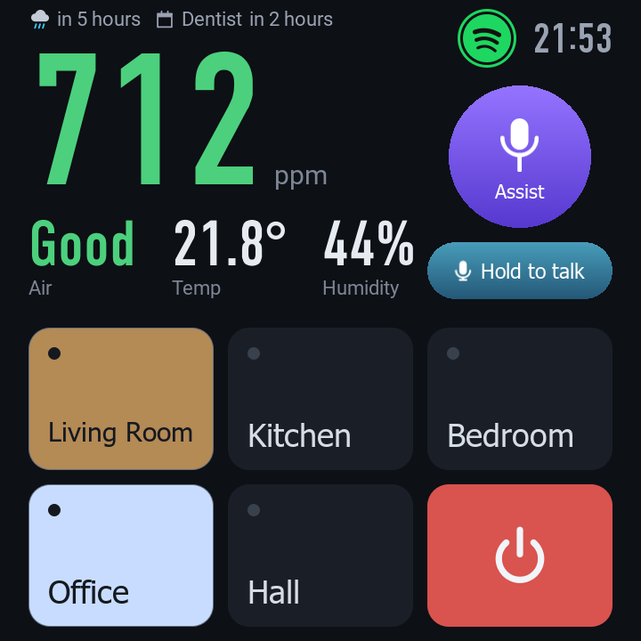
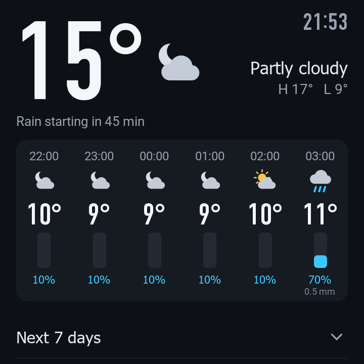
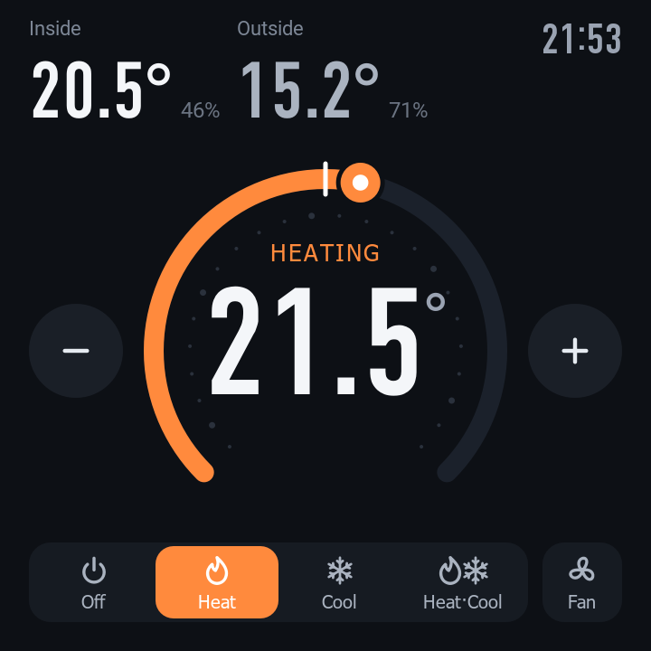
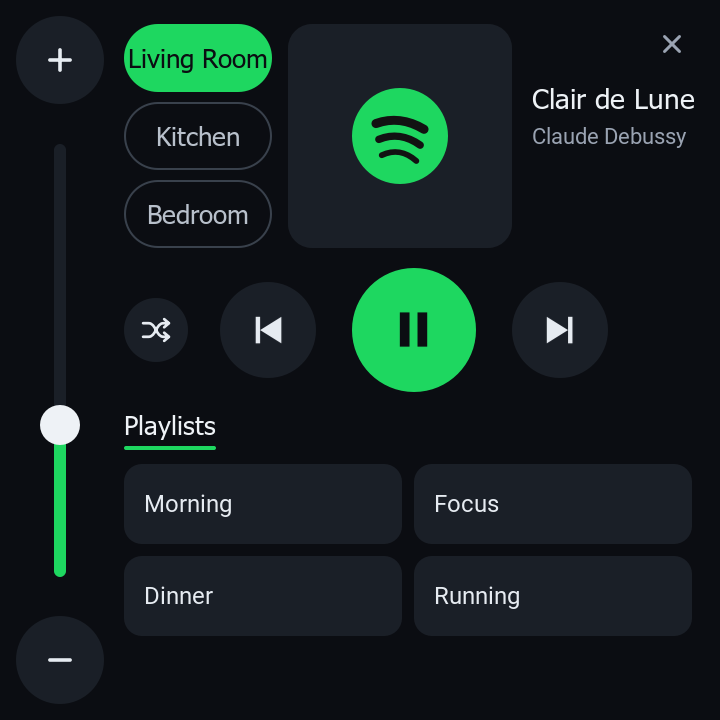
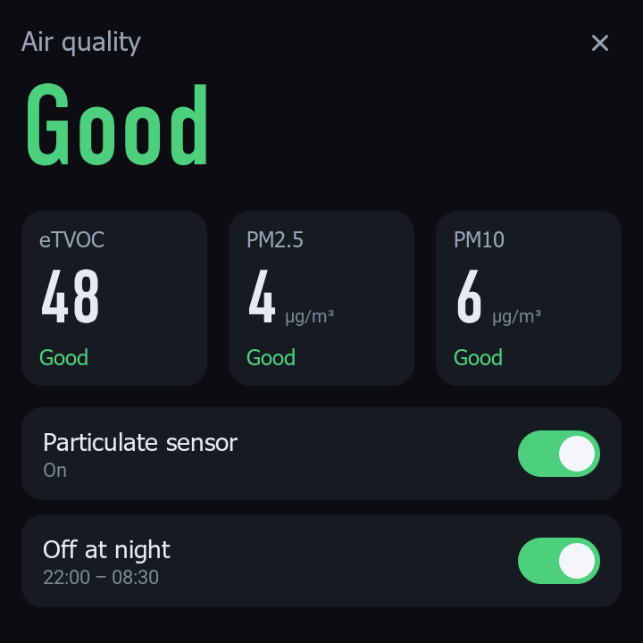
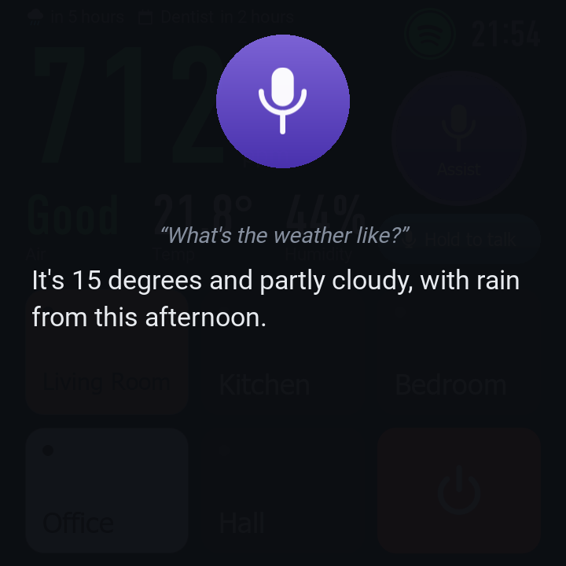
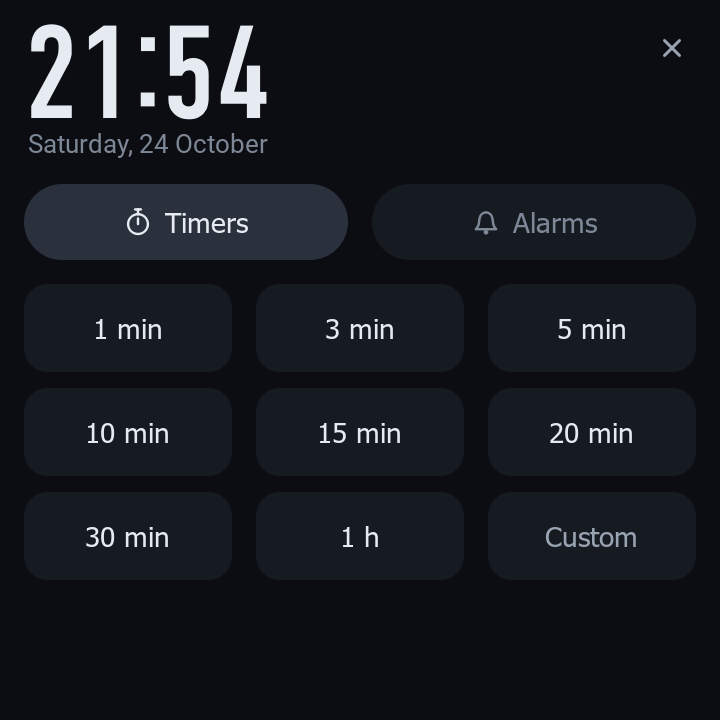
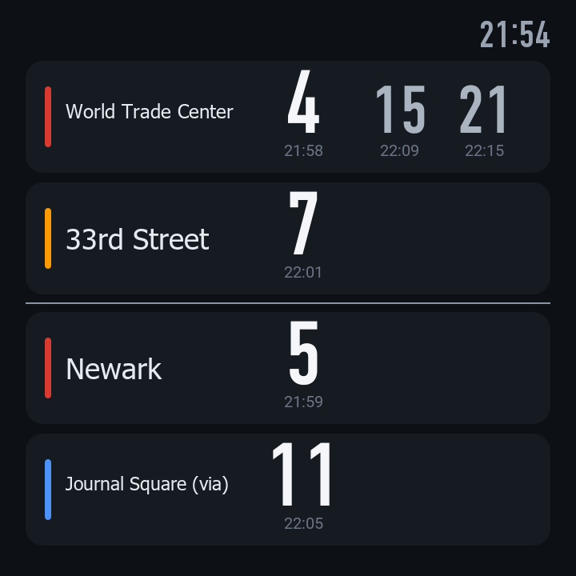

# open-cgs2

Open replacement software for the **Qingping Air Monitor 2 (CGS2)**. It replaces the stock app with
its own sensor daemon and a screen built from components: lights, thermostat, weather, Spotify,
Home Assistant Assist, calendar, doorbell, intercom between units, timers and alarms. It works on
its own, and it fits right in with Home Assistant.

| | | | |
|---|---|---|---|
|  |  |  |  |
|  |  |  |  |

> Unofficial. Not affiliated with or endorsed by Qingping. Installing it may void your warranty; use
> it at your own risk. Both firmware layouts known so far are supported, and the device can always
> boot its stock firmware again.

## Why it beats the stock software

- **No cloud.** Nothing phones home and no account is needed. The stock Mi Home client drops Wi-Fi
  when its cloud is out of reach; open-cgs2 never runs it.
- **Readings in Home Assistant with no integration to install.** MQTT discovery creates the device
  and its sensors, updated every 15 seconds all the time. The stock app reports every 15 minutes
  unless asked, which Home Assistant takes for offline.
- **Humidity that is right.** On at least two devices the stock humidity read 7 to 9 points high
  next to other monitors. open-cgs2 scales it by 0.9 by default, and Settings → Calibration adjusts
  temperature and humidity per device.
- **An eTVOC reading that survives restarts.** The stock app relearns its VOC baseline at every
  start and reports "average air" for a day or more whatever the air does. open-cgs2 keeps what it
  learned and waits for the sensor to warm up after a reboot instead of reporting bad air.
- **Lighter and steadier.** It reads the sensors directly, at under 0.2% of a CPU core where the
  stock app's drivers used 5%, and a particulate sensor that stops answering no longer stalls the
  others.
- **History on the device.** A reading a minute for 2 to 4 weeks and hourly summaries for good, with
  charts from 3 hours to all time, and other rooms from Home Assistant drawn alongside.
- **A screen you choose.** Lights by room, thermostat, weather, Spotify, Assist push-to-talk,
  calendar and meeting alerts, doorbell snapshots, an intercom between units, timers and alarms.
  Components turn on by themselves when Home Assistant has what they need.
- **Extensible.** A component is a folder of QML and a small JSON file; many need no compiling.
- **Locked down.** ADB accepts only your PC's key (stock: root to anyone on the network) and SSH
  takes keys only (stock: root with a published password). LAN-only mode is one switch.
- **Safe to try.** It falls back to the stock firmware after three failed boots, Settings can
  restart into the stock firmware once, and uninstalling restores every file it changed.

## Get started

1. On the device: **Settings → About**, tap **Device Name** 7 times, then in **Developer options**
   turn on ADB. Connect it to Wi-Fi.
2. Download `cgs2` for your computer from [Releases](../../releases) and run it. It finds the device,
   asks a few questions and installs. On Windows, double-click `cgs2-windows-x86_64.exe`.
3. Restart the device when asked.

[Installing](docs/install.md) has the details, the command-line options and how to go back to
stock. [Configuration](docs/configuration.md) covers every setting, and
[Components](docs/components.md) shows how to add your own. [Hardware](docs/hardware.md) describes
the device and how open-cgs2 drives it.

Try the screen on your computer first with the [emulator](docs/components.md#the-emulator):

```bash
python emulator/emulator.py
```

## Credits

- [ea/cgs2_decloud](https://github.com/ea/cgs2_decloud): getting a shell and taking the device off
  the cloud.
- [callumj/Qingping-Air-Monitor-2-Custom-Dash](https://github.com/callumj/Qingping-Air-Monitor-2-Custom-Dash):
  QML on the device's own Qt and EGLFS.
- Sensirion's VOC algorithm, which `sensord` implements with the stock app's tuning.

## License

[MIT](LICENSE)
